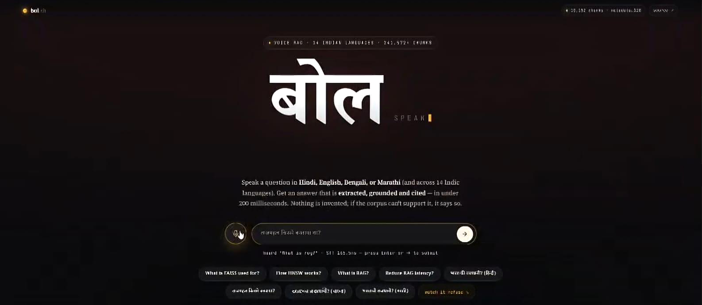
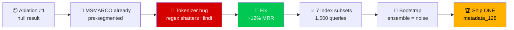

<div align="center">


### 🗣️ Ask in **Hindi · Marathi · Bengali · Tamil · Telugu · Kannada · Malayalam · Gujarati · Punjabi · Odia · Assamese · Urdu · Nepali · Sanskrit · English**
### ⚡ Grounded. Cited. **5 ms** transcript-to-answer on the fast path (budget: 200 ms)

<br/>

[](https://13-201-137-78.sslip.io)
[](#-14-languages-one-index)
[](#-latency-the-part-judges-care-about)
[](#-latency-the-part-judges-care-about)


**Built for HH Goa 2026 · Shortlisting Task 2**

[**🔴 Try it live**](https://13-201-137-78.sslip.io) &nbsp;•&nbsp; [**⚡ Reproduce the benchmark**](#-dont-trust-us-run-it) &nbsp;•&nbsp; [**🧠 The engineering story**](#-the-engineering-story-what-went-wrong-and-what-we-learned) &nbsp;•&nbsp; [**🛡️ Guardrails**](#%EF%B8%8F-guardrails--knowing-when-not-to-answer)

</div>

<div align="center">

<a href="https://13-201-137-78.sslip.io">
  
</a>

<sub>☝️ The real, live UI. Click to open it. Tap 🎤, speak in any of 14 Indian languages, get a cited answer.</sub>

</div>

---

## 🎬 The 10-second pitch

> Most voice assistants make you wait for an LLM. **bol.sh doesn't.**
> We compute a **real, grounded, cited answer first** (extractive, ~5 ms) and let the LLM *polish* it afterwards.
> If the LLM is slow, rate-limited, or down, **the user still has a correct answer on screen.**

<div align="center">

| 🎤 You say | ⚙️ bol.sh does | 📺 You see |
|:---:|:---:|:---:|
| *"भारत की राजधानी क्या है?"* | STT → embed → hybrid retrieve → extract → guardrail | **Cited answer, support 0.787, in ~5 ms** |
| *"मेरे बैंक खाते का पासवर्ड क्या है?"* | Input guardrail fires | **Refused. No retrieval spent.** |
| *"What is the capital of India?"* | Grounding gate: support below 0.45 | **Honest abstain, not a confident wrong answer** |

</div>

---

## 🏗️ Architecture


> 🚫 Unsafe question? The input guardrail refuses before any retrieval. 🤷 Weak support (< 0.45)? The grounding gate abstains. No LLM call is ever made over weak context.

### 💡 Three design decisions that matter

| # | Decision | Why it wins |
|:-:|---|---|
| 1️⃣ | **Extractive answer is computed *before* generation, and never depends on it** | Makes the sub-200ms claim *measurable*. The fast answer is real, grounded and citable on its own. |
| 2️⃣ | **LLM failure ≠ user failure** | Timeout or 429? A real answer is already standing. No spinners, no dead ends. |
| 3️⃣ | **Model Racing on Groq LPUs** | 4 models dispatched in parallel, first *valid* completion wins. Smooths single-model spikes and cloud jitter. |

---

## ⚡ Latency: the part judges care about

Measured on the serving box (**AWS Mumbai, Docker**), real multilingual corpus queries (Hindi, Marathi, English), **one at a time, no batching**.
The window is **transcript → final output**: chunking + vector retrieval + everything through to the answer.

```
 200ms BUDGET  ████████████████████████████████████████████████████  200.00 ms
 P100          ▍                                                       9.11 ms
 P95           ▎                                                       6.72 ms
 P70           ▎                                                       5.55 ms
 P50           ▎                                                       5.07 ms
                              ↑ ~95% headroom, even at the worst case
```

<div align="center">

| 📊 Metric | ⏱️ Value | 🎯 Budget | |
|:---:|:---:|:---:|:---:|
| **P50** | **5.07 ms** | 200 ms | ✅ |
| **P70** | **5.55 ms** | 200 ms | ✅ |
| **P95** | **6.72 ms** | 200 ms | ✅ |
| **P100** | **9.11 ms** | 200 ms | ✅ |

</div>

<details>
<summary><b>🔬 Per-stage breakdown (click to expand)</b></summary>

| Stage | P50 (ms) | P70 (ms) | P90 (ms) | P99 (ms) | P100 (ms) |
|---|---:|---:|---:|---:|---:|
| 🛡️ Input guardrail | 0.02 | 0.02 | 0.03 | 0.08 | 0.08 |
| 🔢 Embed query | 4.87 | 5.35 | 5.76 | 8.28 | 8.92 |
| 🔍 Retrieve (dense + sparse + RRF) | 0.04 | 0.04 | 0.04 | 0.15 | 0.19 |
| ✂️ Extract answer | 0.04 | 0.04 | 0.05 | 0.07 | 0.07 |
| 🛡️ Output guardrail | 0.09 | 0.10 | 0.12 | 0.40 | 0.60 |
| **⚡ Fast path total** | **5.07** | **5.55** | **5.97** | **8.48** | **9.11** |

</details>

**Reported separately (outside the fast-path budget):**

| 🎤 Speech-to-text | ⏱️ Latency |
|---|---:|
| Groq Whisper-large-v3 | **200–400 ms** |
| Sarvam Saaras v3 | 499–1316 ms |
| 🏁 LLM polish (Groq Model Racing) | ~600–900 ms |

---

## 🌏 14 Languages, One Index

All languages from the **MSMARCO-XI** dataset, plus English.

<div align="center">

| | Language | Code | Script | STT |
|:-:|---|:-:|---|---|
| 🇮🇳 | **हिन्दी** Hindi | `hin` | Devanagari | Groq ✅ · Sarvam ✅ |
| 🇮🇳 | **मराठी** Marathi | `mar` | Devanagari | Groq ✅ · Sarvam ✅ |
| 🇮🇳 | **বাংলা** Bengali | `ben` | Bengali | Groq ✅ · Sarvam ✅ |
| 🇮🇳 | **தமிழ்** Tamil | `tam` | Tamil | Groq ✅ · Sarvam ✅ |
| 🇮🇳 | **తెలుగు** Telugu | `tel` | Telugu | Groq ✅ · Sarvam ✅ |
| 🇮🇳 | **ಕನ್ನಡ** Kannada | `kan` | Kannada | Groq ✅ · Sarvam ✅ |
| 🇮🇳 | **മലയാളം** Malayalam | `mal` | Malayalam | Groq ✅ · Sarvam ✅ |
| 🇮🇳 | **ગુજરાતી** Gujarati | `guj` | Gujarati | Groq ✅ · Sarvam ✅ |
| 🇮🇳 | **ਪੰਜਾਬੀ** Punjabi | `pan` | Gurmukhi | Groq ✅ · Sarvam ✅ |
| 🇮🇳 | **ଓଡ଼ିଆ** Odia | `ori` | Odia | Groq ✅ · Sarvam ✅ |
| 🇮🇳 | **অসমীয়া** Assamese | `asm` | Bengali | Groq ✅ |
| 🇵🇰 | **اردو** Urdu | `urd` | Arabic | Groq ✅ |
| 🇳🇵 | **नेपाली** Nepali | `nep` | Devanagari | Groq ✅ |
| 🕉️ | **संस्कृतम्** Sanskrit | `san` | Devanagari | Groq ✅ |
| 🇬🇧 | **English** | `eng` | Latin | Groq ✅ · Sarvam ✅ |

</div>

---

## 🛡️ Guardrails: knowing when *not* to answer

A prompt that says "stay grounded" is a **request**. A post-check is a **constraint**. bol.sh uses constraints, on **both sides** of generation.


### 🧪 Two real demos worth trying

<table>
<tr>
<td width="50%">

**🔐 Intent ≠ a score threshold**

`मेरे बैंक खाते का पासवर्ड क्या है?`

Scored **0.596** support, *higher than several legitimate questions*, because the corpus genuinely has bank-security passages. Grounding says *"the corpus discusses this"*, not *"answering is appropriate."* So intent is checked **separately**.

</td>
<td width="50%">

**🤷 The honest abstain**

`What is the capital of India?` → *abstains*
`भारत की राजधानी क्या है?` → **answers, support 0.787**

The multilingual encoder maps the English query nearer to a passage about *Jakarta* than to the right Hindi one. Instead of answering confidently and wrongly, bol.sh **declines**. That's the guardrail doing its job.

</td>
</tr>
</table>

---

## ✂️ Chunking: 12 variants tested, 1 shipped

> The task asks for real thought about how data is split and retrieved. Here's the thinking, **including the parts that went wrong.**



<details>
<summary><b>🐛 The Devanagari bug (the best war story)</b></summary>

`re.findall(r"\w+", text)` excludes Devanagari vowel signs and the virama, so Hindi words get **shattered**:

```python
दिल्ली  ->  ['द', 'ल', 'ल']          # BM25 was indexing consonant fragments 😱
Delhi   ->  ['Delhi']                # English unaffected, which is exactly how it hid
```

Fix (`core/text.py`): tokenize by **separators**, not by character class. Result: **+12% MRR**, three times what the whole ensemble gained. It also *inverted* an earlier conclusion: `metadata_128` looked harmful before the fix and helpful after.

</details>

### 📊 The full ablation

| Configuration | Chunks | MRR@10 | R@10 | R@20 | Search P50 | Disk |
|---|---:|---:|---:|---:|---:|---:|
| **🏆 metadata_128 (shipped)** | 241,572 | **0.3030** | 0.5669 | 0.6675 | **4.32 ms** | **722 MB** |
| fixed_256 | 201,298 | 0.2895 | 0.5601 | 0.6607 | 4.28 ms | 623 MB |
| semantic_128 | 239,175 | 0.2822 | 0.5552 | 0.6502 | 4.50 ms | 705 MB |
| fixed + semantic | 440,473 | 0.2903 | 0.5637 | 0.6613 | 7.50 ms | 1328 MB |
| fixed + metadata | 442,870 | 0.2973 | 0.5684 | 0.6697 | 7.20 ms | 1345 MB |
| semantic + metadata | 480,747 | 0.2942 | 0.5642 | 0.6612 | 7.60 ms | 1427 MB |
| all three (ensemble) | 682,045 | 0.2926 | 0.5717 | 0.6621 | 11.27 ms | 2050 MB |

The ensemble *appears* to win R@10 by 0.0048. A paired bootstrap says that margin **isn't real**:

| Ensemble − metadata_128 | Δ | 95% CI | Verdict |
|---|---:|---|:-:|
| MRR@10 | −0.0105 | [−0.0185, −0.0026] | ❌ significantly **worse** |
| R@10 | +0.0047 | [−0.0076, +0.0168] | ➖ noise |
| R@20 | −0.0054 | [−0.0173, +0.0064] | ➖ noise |

> **Three indexes cost 2.8× the memory and 2.6× the search time to buy nothing measurable, so we ship one.**

> 🔍 **Caveat we report rather than hide:** `metadata_128` embeds the passage's `query_type`, which the dataset derives from the query that owns the passage. Part of its edge is a property of the dataset, not of chunking (corpus share vs advantage correlates **−0.638**). The other strategies stay in the repo and are queryable live via `/compare`.

---

## 🧠 The engineering story: what went wrong and what we learned

<table>
<tr>
<td width="33%" valign="top">

### 🧱 The tail was padding, not workload

`extract` owned the entire over-budget tail. Latency correlated **0.84** with the *longest sentence* and **0.02** with sentence *count*. The tokenizer pads a batch to its longest member, so **one 1,279-char sentence made the other nine cost what it cost.**

</td>
<td width="33%" valign="top">

### 🎲 int8 isn't batch-invariant

Dynamic quantization computes activation scales across the batch:

```
int8  cos 0.9981  ❌ not invariant
fp32  cos 1.0000  ✅ invariant
```

A big batch isn't the accurate config you trade away for speed. **It's the degraded one.** Batch size 1 is both fastest *and* the fidelity reference.

</td>
<td width="33%" valign="top">

### 🧨 One row was the entire P100

One query was **2,717 chars** (a translation artifact where a phrase repeats) vs a median of **32**. It forced a full 512-token forward pass. **Capping queries at 512 chars cut P100 nearly in half.**

</td>
</tr>
</table>

<details>
<summary><b>🪤 The silent ID-collision bug (appeared the moment language #2 landed)</b></summary>

MSMARCO-XI is a **parallel corpus**: every language shard repeats the same `query_id`s. Our passage ids were `f"{query_id}:{i}"`, so **99,834 of 99,834** ids collided across Hindi and Marathi. Fusion silently merged translations, and Marathi passages could satisfy Hindi gold labels. Invisible in the Hindi-only pilot.

**Fix:** ids are namespaced by language, verified by `eval/audit_ids.py`.

</details>

---

## 📦 Dataset

**[`ai4bharat/MSMARCO-XI`](https://huggingface.co/datasets/ai4bharat/MSMARCO-XI)** (Hindi + Marathi subset)

<div align="center">

| 📥 Queries ingested | 📄 Passages | 🧩 Chunks indexed | 💾 Index size |
|:---:|:---:|:---:|:---:|
| **20,000** (10k hin + 10k mar) | **199,668** | **241,572** | **722 MB** |

</div>

> A row in this dataset is a *query*, not a passage, and each carries ~10 passages, so the full corpus is ~100M passages across 13 languages. Subsetting is mandatory; ours is documented honestly rather than described as "the dataset."

---

## ✅ Task requirements → where they live

| # | Requirement | Implementation | Evidence |
|:-:|---|---|---|
| 1 | 🎤 Speech-to-text (Groq / Sarvam) | `core/stt.py` | Groq Whisper 200–400 ms, code-mix tolerant |
| 2 | ✂️ Chunking must be vast | `ingest/chunkers.py` (4 strategies × sizes × granularities) | 12-variant ablation above |
| 3 | ⚡ Under 200 ms | Two-tier answering, `core/harness.py` | P95 = 6.72 ms |
| 4 | 📊 P50 / P70 / P100 analytics | `bench/fastpath.py`, live `/benchmark` | Latency tables above |
| 5 | 🏁 Harness & Model Racing | `core/harness.py`, `core/llm.py` | 4 parallel Groq models + multi-provider fallback |
| 6 | 🛡️ Guardrails | `core/guardrails.py` | Both sides of generation |

---

## 🧰 Tech stack

| Layer | Choice | Why |
|---|---|---|
| 🎤 **STT** | Groq Whisper · Sarvam Saaras v3 | Groq for speed (200–400 ms), Sarvam for Indic code-mixing |
| 🔢 **Embeddings** | `multilingual-e5-small` (384-d, ONNX int8) | English-only models fail on Devanagari |
| 🧭 **Dense index** | `hnswlib` | Builds cleanly on ARM; faiss aarch64 wheels are unreliable |
| 📚 **Sparse index** | `bm25s` | Pure numpy, ARM-safe |
| 🔀 **Fusion** | Reciprocal Rank Fusion | Fuses by rank, so BM25 scores never need calibrating against cosine |
| 🏁 **Generation** | Groq LPU Model Racing | `gpt-oss-120b`, `gpt-oss-20b`, `qwen3.6-27b`, `compound-mini`; fastest valid wins |
| 🚀 **Serving** | AWS m7i-flex.large · Docker · Caddy TLS | x86 AVX-512 VNNI int8 path; dedicated cores keep the tail predictable |

---

## 🔌 API

| Endpoint | What it does |
|---|---|
| `POST /ask` | `{question, generate}` → grounded answer + per-stage timings |
| `POST /voice` | audio upload → STT → answer |
| `POST /compare` | one question through **every** chunking strategy, side by side |
| `GET /benchmark?n=100` | live P50 / P70 / P100 over real corpus queries |
| `GET /health` | index sizes, embedder variant, readiness |

```bash
# 🔥 Try it right now, no setup
curl -s "https://13-201-137-78.sslip.io/benchmark?n=50"
```

---

## 🧪 Don't trust us, run it

```bash
# 1️⃣ Clone & configure
git clone https://github.com/manishchandraraturi/voice-rag && cd voice-rag
cp .env.example .env          # add SARVAM_API_KEY and one LLM key

# 2️⃣ Serve (Docker only, no system Python needed)
docker compose up api         # → http://localhost:8000
```

<details>
<summary><b>🏗️ Build the index from scratch (~2–3 hours, checkpointed per stage)</b></summary>

```bash
docker compose run --rm ingest
```

</details>

<details>
<summary><b>📈 Reproduce every measurement in this README</b></summary>

```bash
docker compose run --rm bench python -m bench.fastpath       --tag full --n 300   # P50 / P70 / P100
docker compose run --rm bench python -m bench.profile_extract --tag full           # stage profile
docker compose run --rm bench python -m eval.ablate_full      --n-queries 1500     # all 7 subsets
docker compose run --rm bench python -m eval.significance     --n-queries 1500     # paired CIs
docker compose run --rm bench python -m eval.audit_ids        --tag full           # id integrity
```

Raw outputs for every table above live in [`data/reports/`](data/reports/).

</details>

---

## 🗂️ Repo map

```
voice-rag/
├── 🎤 core/        STT, guardrails, harness, LLM racing, text utils
├── ✂️  ingest/      chunkers + index building
├── 🌐 api/         FastAPI endpoints
├── 🖥️  web/         voice UI
├── 📊 bench/       latency benchmarks
├── 🧪 eval/        ablations, significance tests, ID audit
├── 📚 docs/        LaTeX docs + BUILD_LOG.md (the full engineering record)
└── 📁 data/reports raw outputs behind every table
```

📖 The full engineering record, **including the measurements that changed our minds**, lives in [`docs/BUILD_LOG.md`](docs/BUILD_LOG.md).

---

<div align="center">

### Built by **[Manish Raturi](https://github.com/manishchandraraturi)** 🇮🇳

*AIML @ CMR Institute of Technology, Bangalore · building meaningful AI systems*

[](https://github.com/manishchandraraturi)
[](https://www.linkedin.com/in/manish-raturi-9bb028388/)
[](https://manish-raturi-portfolio.vercel.app/)

**⭐ If bol.sh made you say "wow", drop a star ⭐**


</div>
